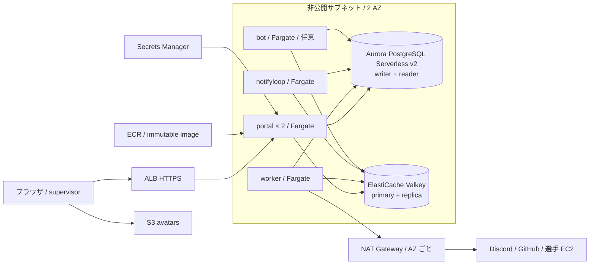

# AWS ECS Fargate へのデプロイ

競技ポータルを ARM64 の ECS Fargate で実行します。
webapp と同じ TypeScript の Pulumi が AWS 基盤を管理し、[ecspresso](https://github.com/kayac/ecspresso) が ECS タスク定義とサービスを管理します。
ポータルと webapp は別の Pulumi project / stack として管理します。
Pulumi は ECS サービスやタスク定義を作成しません。
旧環境の state は流用せず、ポータル用の Pulumi stack を作成してください。

## 構成



[ISUCON14 の Terraform](https://github.com/isucon/isucon14-portal/tree/4c2b99a/terraform/modules/isuxportal) と [ECS 定義](https://github.com/isucon/isucon14-portal/tree/4c2b99a/ecs)を参考に、サービス分割、ARM64 Fargate、ALB、マネージド DB/キャッシュ、ECR、S3 を引き継いでいます。
現在の Go 実装に合わせ、非同期ジョブは PostgreSQL の `jobs` テーブルを使います。
SQS、Rails、nginx サイドカー、選手用 benchmarker クラスタはこのデプロイの対象外です。
ecspresso の Jsonnet 定義は `ecspresso/` に置きます。
Pulumi はリソース ID、ARN、非秘密のアプリケーション設定を S3 の `infra.json` に出力します。
デプロイ時にこのファイルを取得し、Jsonnet が読み込みます。
CI は Pulumi の state や backend の認証情報にアクセスする必要がありません。
ecspresso のバージョンは `.ecspresso-version` で固定します。

| 対象 | 既定値と選定理由 |
|---|---|
| Node.js | 24 LTS。SPA のビルド専用。[リリース表](https://nodejs.org/en/about/previous-releases) |
| Go | 1.26 系。LTS 制度はないため、既存プロジェクトの系列を維持 |
| 実行 OS | Debian 13 trixie。現行 stable。[サポート情報](https://www.debian.org/releases/) |
| Aurora | PostgreSQL 17.7 LTS / Serverless v2。[AWS の LTS 表](https://docs.aws.amazon.com/AmazonRDS/latest/AuroraPostgreSQLReleaseNotes/aurorapostgresql-release-calendar.html) |
| キャッシュ | ElastiCache Valkey 8.2。TLS、保存時暗号化、Multi-AZ。[対応エンジン](https://docs.aws.amazon.com/AmazonElastiCache/latest/dg/engine-versions.html) |
| Fargate | Linux platform 1.4.0、ARM64、各タスク 0.5 vCPU / 1 GiB |

Aurora は 2 AZ に `db.serverless` を 1 台ずつ配置します。
各インスタンスの容量範囲は 2〜16 ACU で、自動停止を無効にしています。
reader の昇格優先度は 1 とし、フェイルオーバーに備えます。
アプリケーションは読み書きとも writer endpoint に接続します。
`auroraMinAcu` と `auroraMaxAcu` は負荷試験後に調整してください。
LTS のマイナーバージョンを維持するため、自動マイナー更新は無効です。
セキュリティ修正は検証後に明示的に適用します。

## 初回構築

1. [Pulumi README](pulumi/README.md) に従って AWS 基盤を作成します。
2. [外部連携設定](external-integrations.md) に従って Secrets Manager の値を登録します。
3. 対象コミットの ARM64 イメージを ECR に push し、`deploy.sh` でデプロイします。

```sh
export AWS_REGION=ap-northeast-1
export PORTAL_ECR_REPOSITORY=<Pulumi output ecrRepositoryUrl>
export PORTAL_CONFIG_URI=<Pulumi output ecspressoConfigUri>
aws ecr get-login-password --region "$AWS_REGION" \
  | docker login --username AWS --password-stdin "${PORTAL_ECR_REPOSITORY%%/*}"
tag="$(git rev-parse HEAD)-$(date -u +%Y%m%d%H%M%S)"
docker buildx build --platform linux/arm64 --push \
  -f portal/deploy/Dockerfile --build-arg REVISION="$(git rev-parse HEAD)" \
  -t "$PORTAL_ECR_REPOSITORY:$tag" portal
export IMAGE_DIGEST="$(aws ecr describe-images --region "$AWS_REGION" \
  --repository-name "${PORTAL_ECR_REPOSITORY#*/}" --image-ids imageTag="$tag" \
  --query 'imageDetails[0].imageDigest' --output text)"
sh portal/deploy/deploy.sh
```

ECR のタグは immutable なので、コミットと時刻を組み合わせた一意のタグで push します。
x86_64 のホストでビルドする場合は QEMU によるエミュレーションを有効にしてください。
`deploy.sh` は digest を固定して `migrate` タスクを 1 回実行します。
`ecspresso run --wait --watch-container migrate` が終了コードを検査します。
成功した場合だけ各サービスを `ecspresso deploy --wait --wait-until deployed` で更新します。
ECS の circuit breaker が旧 revision に戻した場合も、`deploy.sh` は失敗します。
初回サービス作成時は過去の正常 revision がないため、自動ロールバック先はありません。

`portal` は既定 2 タスク、`worker` と `notifyloop` は 1 タスクです。
`bot` は既定 0 タスクで、`enableBot: true` と token 設定後に有効化します。

移行準備中は Pulumi の `standby: true` を設定します。
この設定では portal は2タスク、worker と notifyloop は0タスクになります。
Botも既定では0タスクですが、`enableBot: true` と `enableBotInStandby: true` を併用すると待機中でも1タスクで起動します。
参加者への公開を防ぐ場合は、あわせて `environment.ISUXPORTAL_ADMIN_ONLY: "1"` を指定してください。
切替時は最新データの取り込みと照合を終えてから、運営の判断で待機設定を解除して再デプロイします。

DNS を変更せず既存の ACM 証明書を使う場合は、`dnsManagement: external` と `existingCertificateArn` を指定します。
証明書は ALB と同じリージョンに必要です。
この組み合わせでは証明書の発行・検証や DNS レコード作成を行いません。
インポートした証明書の秘密鍵はリポジトリに保存せず、更新は証明書の管理者が行ってください。
ACM の参照だけでは、インポート証明書の自動更新は有効になりません。

タスク数は `ecspresso/service.jsonnet` の `desiredCount` で管理し、更新時にその値を適用します。
一時的に手動スケールした値も次回デプロイで定義の値に戻ります。
Botを確実に停止するときは `enableBot: false` と `enableBotInStandby: false` の両方を設定してデプロイします。
`bot` と `notifyloop` は新旧の重複実行を避けるため、一度停止してから更新します。
これらの desired count は 1 以下を維持してください。

ECR に push 済みのイメージを再デプロイするときは、ビルドを省いて digest だけを指定します。

```sh
export PORTAL_CONFIG_URI=s3://<config-bucket>/infra.json
export IMAGE_DIGEST=sha256:<64桁のdigest>
sh portal/deploy/deploy.sh
```

同じ環境に対して `deploy.sh` を同時に実行しないでください。

本番移行時のデータ保全、DNS確認、通常稼働への切替、切り戻しは [ポータル切替手順](../../docs/research/portal-cutover.md) を参照してください。

## 更新と復旧

Pulumi の設定を変更した場合、`pulumi up` 後にデプロイを実行すると S3 の新しい接続情報が反映されます。
タスクの CPU、メモリ、プロセスの設定、更新方法は `ecspresso/` の Jsonnet を変更してデプロイします。
秘密値の変更も既存タスクには反映されないため、同じ digest を指定して再デプロイしてください。
Aurora 管理の DB パスワードは自動ローテーションされます。
ローテーション後は新しい接続に新パスワードが必要になるため、運用で全サービスの再デプロイを行います。
競技中のローテーションを避けるスケジュールを Secrets Manager で設定してください。

アプリケーションを切り戻す場合は、`IMAGE_DIGEST` に以前の正常な digest を指定して `deploy.sh` を実行します。
タスク単位のログは `/ecs/<name>` の `portal` / `worker` / `bot` / `notifyloop` / `migrate` ストリームに出力されます。
途中で失敗した場合、先に更新済みのサービスは新 revision のままです。
修正後の再実行、または旧 digest での全サービス再デプロイで揃えてください。
マイグレーションは下方向への変更を行いません。
旧アプリケーションが新スキーマで動作することを確認してから切り戻します。
ECR のイメージは自動削除しないため、復旧に必要な digest を保持したうえで手動整理します。

Aurora は 14 日間の継続バックアップ、削除保護、削除時の最終スナップショットを有効にしています。
Valkey は 7 日間のスナップショットを保持します。
DB の復元は別クラスタに行い、接続先の更新と整合性確認を経て切り替えます。
定期的に復元と Aurora フェイルオーバーを検証してください。
ALB の監視は `/site/sha` によるプロセスの生存確認で、DB/キャッシュの継続的な疎通確認ではありません。
ALB の HealthyHostCount/5xx と Aurora ACU 使用率には CloudWatch Alarm を用意しています。
Pulumi output `alertsTopicArn` の SNS topic に通知先を登録し、購読を確認してください。
TargetResponseTime、ECS タスク数、Aurora 接続数、Valkey メモリ、ジョブ滞留の閾値は負荷試験後に追加します。

## 旧環境からの移行

旧 Ansible/Swarm の適用や削除は実行しません。
AWS 用の state と別の検証用 FQDN で構築し、[登録情報移行](../docs/registration-migration.md)と合わせてリハーサルしてください。
既存 PostgreSQL 18 から Aurora 17 へ物理バックアップを復元することはできません。
論理エクスポートとインポートを使い、使用型、SQL、件数、参照関係を検証します。
Redis のセッションを移さない場合は利用者の再ログインが必要です。
アイコンは旧バケットから新バケットへコピーします。

切替時は旧環境の書き込みを停止し、最終データを移してから DNS を変更します。
この Pulumi project は指定した FQDN の Route 53 レコードを管理するため、初期検証時に現行本番 FQDN を指定しないでください。
新環境は `ISUXPORTAL_ADMIN_ONLY=1` で起動します。
OAuth、Discord、S3、選手 SSH、bench/checker の確認、900 チーム以上の負荷試験、復元試験が済んでから公開モードへ切り替えます。
開催日は 2026 年 10 月 31 日です。
競技時刻は確定した値だけを `environment` に設定します。

## 検証

```sh
# ecspresso は .ecspresso-version のバージョンを使用
npm --prefix portal/deploy/pulumi ci
npm --prefix portal/deploy/pulumi run typecheck
npm --prefix portal/deploy/pulumi test
python3 -m unittest discover -s portal/deploy/tests -v
cd portal
go test ./cmd/migrate ./internal/... ./tests/contract
docker build -f deploy/Dockerfile -t isuxportal:local .
```

Pulumi のテストは runtime mocks を使い、AWS の作成や課金を発生させません。
実アカウントでの IAM、エンジン提供状況、クォータ、疎通の検証は staging で別途行います。

## 環境固有の移行記録

本番の接続先、証明書参照、バックアップ保存先、切替前の検証結果は[非公開の移行手順](https://github.com/isucon/isucon2026-private/tree/codex/portal-discord-environment/ops/production-portal)で管理します。
公開リポジトリには実際の環境 ID や移行元データを保存しません。

## Discord invitation and account linking

Discord OAuth identifies the user; it does not automatically join the Discord server.
After linking, users must join with the same Discord account using an invitation.
The registration and contestant pages prefer `ISUXPORTAL_DISCORD_INVITE_URL` when set,
and otherwise obtain `instant_invite` from the server widget.
If neither provides an invitation, the pages ask users to contact the organizers.

When the widget returns `instant_invite: null`, store a valid invitation for the
configured server as `ISUXPORTAL_DISCORD_INVITE_URL` in the application JSON secret
in Secrets Manager. Preserve the other keys when updating the secret. Add only
the key name to the target Pulumi stack's `secretKeys` list, and remove it from
`environment` if it was previously configured there. Never put the invitation
value in stack configuration or deployment definitions.

Apply the stack with `pulumi up`, then redeploy through ecspresso as described above.
ECS retrieves the value from Secrets Manager when starting each application task.
Do not update only the ECS task or generated S3 configuration.
The invitation is displayed to portal users; do not use an operator-only invitation.
Account linking and subsequent Discord logins synchronize membership and contestant
roles after the identity update. Existing affected users can log in with Discord
again after deployment to retry synchronization. Users outside the server must
still accept the invitation first.

### Periodic account reconciliation

The worker checks a durable schedule at startup and every minute. Once per hour
it queues SSH key, Discord membership, and Discord contestant-role checks, spread
across the following hour. No additional service or public HTTP endpoint is used.
The migration `004_periodic_job_schedules.sql` must run before the updated worker
starts; the normal deployment runs migrations before updating services.

SSH keys are refreshed for active teams via the public GitHub `.keys` endpoint,
without retaining user OAuth tokens. Discord checks run only when the worker has
a Bot token and the contestant has a linked Discord ID. Discord roles are also
checked for disqualified/withdrawn teams so that undesired roles can be removed.
Reconciliation does not automatically join users to Discord, and SSH key refresh
updates the portal's key records, not `authorized_keys` on existing contest VMs.

Pending/running checks are not duplicated by the next cycle. Each check uses the
existing job retry/backoff policy independently; a failed GitHub fetch preserves
the previously stored keys and does not block Discord reconciliation. Dead jobs
remain available for diagnosis and a later hourly cycle schedules a fresh check.
The schedule is persisted in PostgreSQL, so worker restarts and overlapping
workers do not start duplicate hourly cycles. Worker downtime delays checks until
it resumes; queue backlog and external service errors can delay completion.
